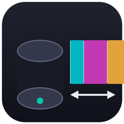

# DiskForge — Partition & Recovery Suite

A modern, high-performance Windows partition manager and data-recovery application built with **C++ / WinUI 3 / Windows App SDK**. Dark-mode-first Fluent UI, fully resizable, portable (no installation), and driven by a platform-independent disk engine whose core is covered by **51 unit tests + a real-VHD integration suite** that runs in CI on every push.



> **Requires Administrator.** All disk operations need elevation — the app requests it via UAC on launch.

---

## Features

### Partition management (basic + advanced)
| Operation | Notes |
|---|---|
| Create partition | NTFS / FAT32 / exFAT, label + drive letter, 1 MiB aligned |
| Delete partition | incl. MBR logical partitions inside extended partitions |
| Format partition | via Windows format engine with FAT32 engine fallback |
| Resize / extend / shrink | NTFS online (FSCTL), FAT32 offline via engine (with cluster compaction) |
| Move partition | overlap-safe sector copy + boot-sector fixups + letter preservation |
| Split partition | shrink + create in one step |
| Merge partitions | file-safe: copies the source into a `Merged_...` folder first, then absorbs the space |
| Change label / drive letter | |
| Set active partition | MBR boot flag |
| Hide / unhide | MBR type byte (0x1x) or GPT no-drive-letter attribute |
| Change type ID | MBR hex byte or GPT type GUID presets |
| Initialize disk | GPT or MBR on blank disks |
| Allocate free space | moves free space between non-adjacent partitions (slides intervening partitions) |
| 1-click extend | finds unallocated space anywhere on the disk, relocates it, extends — the "extend C: without reinstalling" flow |

### Data recovery
| Capability | Notes |
|---|---|
| Recover deleted files (NTFS) | full MFT walk with USA fixups, runlists, deleted-record detection, orphan → `Lost Files` |
| Recover deleted files (FAT32) | 8.3 + LFN reconstruction (lenient checksum for deleted entries), contiguous-chain heuristic |
| Recover lost partitions | boot-sector scanning (quick grid + full sector-by-sector), GPT backup repair, overlap detection, one-click restore |
| Signature carving | JPEG, PNG, GIF, BMP, PDF, ZIP (Office), RAR, 7z, MP4 (exact atom-walk sizing), MP3, WAV, OLE documents |
| Sources | any partition, whole disk incl. unallocated areas, HDD / SSD / USB |

### Safety
- Every destructive action requires explicit confirmation (toggleable).
- Global **read-only mode** that blocks all writes (Settings).
- Partition-table writes go through `IOCTL_DISK_SET_DRIVE_LAYOUT_EX` (Windows maintains both GPT copies), with engine fallbacks for repair paths.
- Move operations copy first and update the table last — a crash or cancel leaves the original data intact.
- Full activity log (view + export), kept in `%APPDATA%\DiskForge`.

## Download

Grab **`DiskForge-1.0.0-win-x64.zip`** from the [Releases](../../releases) page, extract, and run `DiskForge.exe`. No installation, no MSIX, self-contained Windows App SDK runtime.

## Build from source

Prerequisites: Visual Studio 2022 (C++ desktop + WinUI workload), Windows SDK, .NET for NuGet.

```powershell
git clone https://github.com/Nomandiu/diskforge
cd diskforge
# optional: pin NuGet packages to the newest stable versions
./tools/set-nuget-versions.ps1
nuget restore DiskForge.sln -PackagesDirectory src/app/packages
msbuild DiskForge.sln -m -p:Configuration=Release -p:Platform=x64
```

Engine-only (cross-platform, runs on Linux/macOS too):

```bash
cmake -S . -B build && cmake --build build && (cd build && ctest)
```

## Architecture

```
src/
├─ engine/                 # platform-independent disk engine (C++17, no UI deps)
│  └─ df/
│     ├─ mbr.* gpt.*       # partition tables incl. EBR chains + GPT repair
│     ├─ layout.*          # unified layout model, free-extent math
│     ├─ fsprobe.*         # NTFS/FAT/exFAT detection + validation
│     ├─ fat.*             # FAT12/16/32: parse, format, OFFLINE RESIZE (cluster
│     │                    #   compaction + region move), deleted-file recovery
│     ├─ ntfs.*            # MFT/USA fixups/runlists, deleted + orphan recovery
│     ├─ carve.*           # signature carving with exact-size strategies
│     ├─ scan.*            # lost-partition scanner (quick/full)
│     ├─ diskio.*(+_win)   # device abstraction + overlap-safe copy engine
│     └─ ops.h(+ops_win)   # Windows service layer: ioctls, format, letters,
│                          #   resize/move/split/merge/allocate/1-click, recovery
├─ app/                    # WinUI 3 application
│  ├─ Pages/               # Dashboard, Disk details, File recovery,
│  │                       #   Partition recovery, Operations, Log, Settings
│  ├─ Dialogs/             # Create / Resize-Move / Split / Merge / Allocate
│  ├─ ViewModels/          # x:Bind runtime classes
│  └─ Services/            # AppContext (jobs, logging), UI helpers
└─ tests/                  # 51 unit tests + Windows VHD integration suite
```

See [docs/ARCHITECTURE.md](docs/ARCHITECTURE.md) and [docs/SAFETY.md](docs/SAFETY.md) for details.

## Testing

- **51 engine unit tests** (run on Linux and Windows in CI): table round-trips, CRC vectors, GPT backup recovery, FAT32 format/read/write/shrink/extend/compact with byte-exact content verification, synthetic-NTFS parsing with fragmented $MFT and multi-run deleted files, carving exactness, lost-partition scan/restore.
- **Integration suite on real VHDs** (Windows CI): initialize GPT → create FAT32 → write files via Win32 → shrink → verify content via engine → extend → verify → create NTFS → move → label/letter/hide → split → delete → scan → restore → deleted-file recovery with content comparison.
- **App smoke test**: the built exe must start and keep its window alive.

## Limitations & honest notes

- Moving the **Windows system partition (C:) itself** is refused while Windows runs (online move would be unsafe); extending C: works whenever free space can be made adjacent — which is exactly what *Allocate free space* / *1-click extend* automate.
- exFAT **shrinking** is not supported (NTFS and FAT32 are).
- MBR disks support up to 4 primary partitions in the UI (logical partitions are read and can be deleted).
- Recovery quality for deleted files depends on how much of the data has been overwritten since deletion; the UI marks estimated sizes.

## License

MIT — see [LICENSE](LICENSE).
